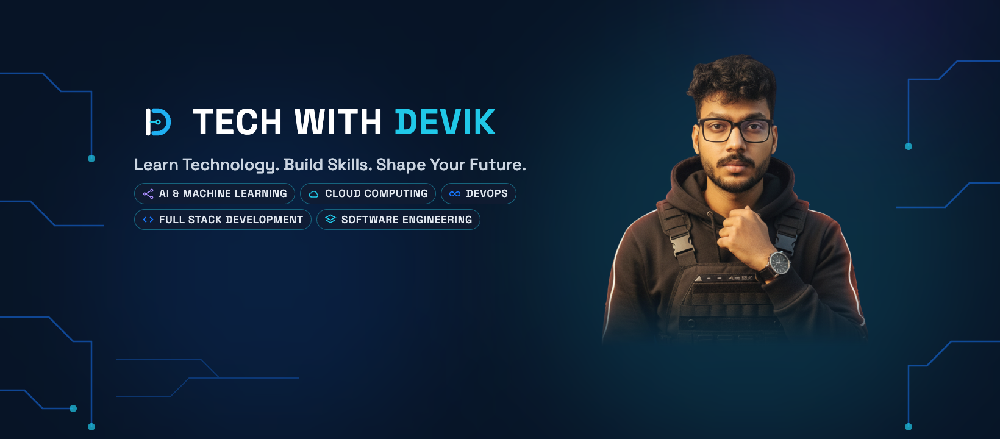

# Hey Everyone 👋, I'm Devik Sharma

  

<h3 align="center">
  Technology Enthusiast | Cloud & DevOps Engineer | Tech Content Creator 🇮🇳
   
  Exploring Technology, Building Projects & Sharing Knowledge
   
  <a href="https://www.youtube.com/@techwithdevik" target="_blank">Tech with Devik</a>
</h3>

---

  
  
  

  

---

## 👨‍💻 About Me

I'm Devik Sharma, a technology enthusiast and IT professional passionate about exploring modern technologies, building real-world projects, and sharing practical knowledge.

Through **Tech with Devik**, I aim to make technology easier to understand for beginners, students, and working professionals.

- 🚀 Exploring the latest technologies and industry trends.
- ☁️ Learning and building with Cloud Computing and AWS.
- ⚙️ Working with DevOps, CI/CD, Docker, Kubernetes & Automation.
- 🤖 Exploring Artificial Intelligence and emerging technologies.
- 💻 Building practical projects and experimenting with new tools.
- 📚 Sharing technical knowledge through tutorials and educational content.
- 🌐 Website: https://techwithdevik.com
- 📺 YouTube: https://youtube.com/@techwithdevik

---

## 🛠️ Technologies & Areas of Interest

### ☁️ Cloud & DevOps

  

### 💻 Programming & Development

  

### 🔧 Tools & Automation

  

### 🤖 Emerging Technologies
- Artificial Intelligence & Generative AI
- AI-powered Automation
- Cloud-Native Technologies
- Infrastructure as Code
- Modern Software Engineering

---

## 🚀 Featured Projects

Here are some areas where I build and experiment with technology:

- ☁️ AWS Cloud Infrastructure & Automation
- ⚙️ CI/CD Pipeline Implementation
- 🐳 Docker & Kubernetes Projects
- 🔄 Infrastructure as Code with Terraform
- 🐧 Linux Administration & Bash Automation
- 🤖 AI & Technology Experiments

Explore my repositories: **https://github.com/techwithdevik**

---

## 📊 GitHub Statistics

---

## 🔥 GitHub Contribution Streak

  

---

## 🌐 Connect With Me

  
  
  

- 📺 YouTube: https://youtube.com/@techwithdevik
- 🌐 Website: https://techwithdevik.com
- 💼 LinkedIn: https://linkedin.com/in/thedevikofficial
- 📸 Instagram: https://instagram.com/techwithdevik

---

## 🤝 Open to Collaborations

- 🚀 Technology & Open-Source Projects
- ☁️ Cloud & DevOps Collaborations
- 🤖 AI & Automation Projects
- 🎤 Guest Sessions & Technical Webinars
- 💡 Knowledge Sharing & Learning Opportunities

---

  <b>Technology Education & Cloud Engineering Platform</b>
   
  Learning | Building | Exploring | Sharing

  <i>"Stay curious, keep building, and never stop exploring technology."</i>

